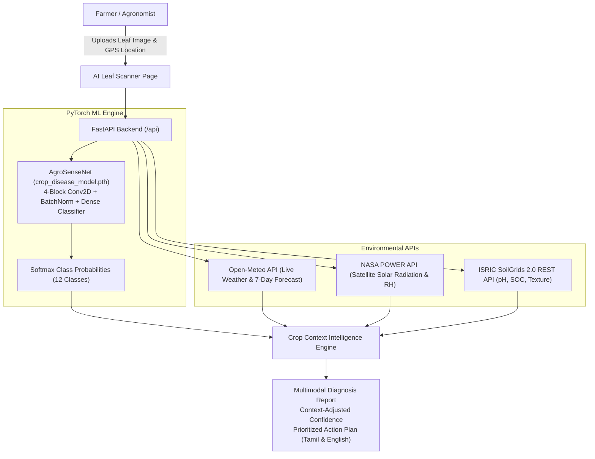

# AgroSense AI — An Intelligent Multimodal Agricultural Diagnostic Platform

AgroSense AI is an intelligent, multimodal precision agriculture platform that transcends basic visual leaf disease diagnosis by fusing **computer vision models**, **NASA POWER satellite agroclimatology**, and **ISRIC SoilGrids pedological intelligence**.

---

## 🌾 The Core Problem Solved

Traditional crop disease detection tools rely entirely on raw leaf image classification. In real-world agriculture, visual symptoms such as leaf chlorosis or necrosis can easily be confounded:
- **Visual ambiguity**: Water stress, fertilizer burn, or sunscald can visually mimic fungal blights.
- **Micro-climatic mismatch**: Fungal pathogens like *Phytophthora infestans* (Late Blight) require sustained leaf wetness and high relative humidity (>80%) with cool temperatures (15-22°C). Diagnosing Late Blight in dry 40°C weather leads to inappropriate and hazardous chemical fungicide usage.
- **Soil predisposition**: Root infections, boron deficiency, or acidic soil (pH < 5.5) weaken plant cuticles, predisposing foliage to secondary pathogens.

**AgroSense AI** solves this with the **Crop Context Intelligence Engine**, a 7-step diagnostic workflow:
1. **Vision Inference**: PyTorch-trained Convolutional Neural Network (*AgroSenseNet*) extracts morphological lesion signatures.
2. **Micro-Climate Retrieval**: Real-time ambient weather (Open-Meteo) and satellite agroclimatology (NASA POWER API) are queried for the farm's exact GPS coordinates.
3. **Pedological Soil Analysis**: ISRIC SoilGrids 2.0 REST API retrieves topsoil and subsoil pH, Soil Organic Carbon (SOC), and USDA sand/silt/clay fractions.
4. **Agronomic Alignment**: Farmer-observed symptoms and growth stage are factored into the epidemiological rule engine.
5. **Contextual Corroboration**: Cross-verifies pathogen biology with current environmental parameters, producing both a raw model confidence and a **Context-Adjusted Confidence**.
6. **Mismatch Flagging**: Anomaly alerts flag environmental contradictions before advising chemical interventions.
7. **Actionable Checklist**: Generates prioritized, organic-first remedies (Panchagavya, Trichoderma, Neem oil) and KVK referral protocols.

---

## 🎨 Design System & Color Palette

The entire platform UI/UX is built with an agricultural green aesthetic using the specified palette:
- `#F4F9F4` — Canvas & Page Background Tint
- `#CFE1B9` — Soft Sage Green (Cards, Badges, Borders)
- `#97A97C` — Muted Foliage Green (Sub-headings, Secondary Accents)
- `#718355` — Vibrant Deep Green (Pills, Gauges, Icons)
- `#4A5D23` — Rich Earthy Forest Green (Hero Elements, Dark Cards, Active Navigation)

---

## 🚀 System Architecture



---

## 🖥️ Website Pages & Capabilities

1. **Landing Page**: Compelling hero section, 7-step pipeline visual, and feature navigation cards.
2. **Farmer Dashboard**: Direct implementation of the precision agriculture dashboard with weather card, plant health (95%), active zones (9), satellite field map, soil nutrient status, interactive auto watering switch, pH balancer, fertilizer application level, circular growth analytics gauge (87%), and AI Assistant widget.
3. **Smart Leaf Scanner**: Drag-and-drop leaf upload, sample leaf selector, growth stage selector, symptom checklist, scanning animation, real model inference, and multimodal contextual report.
4. **Micro-Climate Risk Map**: Location selector (Coimbatore, Thanjavur, Madurai, Salem, Ooty, Nashik, Punjab), live Open-Meteo weather, NASA POWER satellite solar radiation, and disease risk indicators.
5. **Soil Intelligence**: Real ISRIC SoilGrids REST API depth profiling (0-5cm, 5-15cm, 15-30cm), pH meter, soil organic carbon, and USDA soil texture classification.
6. **Diagnosis Reports & Timeline**: Historical scans archive, side-by-side temporal recovery comparison (Day 1 vs Day 7), and printable report view.
7. **What-If Farm Simulator**: Interactive sliders for Temperature, Relative Humidity, Rainfall, Irrigation method, and Nitrogen level calculating real-time disease pressures.
8. **Tamil AI Assistant**: Conversational agronomist answering queries in Pure Tamil, English, and Tanglish (e.g., *"En tomato chediyoda ilai yen manjal aagudhu?"*), complete with organic recipes like Panchagavya and KVK helpline numbers.
9. **About & Data Sources**: Complete architectural disclosure, dataset citations, limitations, and college project evaluation credits.

---

## 🛠️ Quickstart: Running on Localhost

### 1. Prerequisites
- Python 3.10+ (PyTorch, FastAPI, Uvicorn installed)
- Node.js v18+ & npm

### 2. Backend Setup & Run
```bash
# Navigate to backend directory
cd backend

# Start the FastAPI server on port 8000
python -m uvicorn main:app --host 0.0.0.0 --port 8000 --reload
```
The FastAPI backend will start at `http://localhost:8000`. Swagger API documentation is available at `http://localhost:8000/docs`.

### 3. Frontend Setup & Run
```bash
# Navigate to frontend directory in another terminal
cd frontend

# Start the Vite development server
npm run dev
```
The application will launch on `http://localhost:5173`.

---

## 📊 Model Training Metadata

- **Architecture**: 4 Conv-BatchNorm-ReLU-MaxPool Blocks + AdaptiveAvgPool2d + Dense Classifier with Dropout.
- **Parameters**: 2,554,252 trainable parameters.
- **Validation Accuracy**: 77.08%.
- **Weights File**: `backend/models/crop_disease_model.pth`.
- **Classes**: Tomato Early Blight, Tomato Late Blight, Tomato Healthy, Potato Early Blight, Potato Late Blight, Potato Healthy, Corn Common Rust, Corn Healthy, Rice Blast, Rice Brown Spot, Pepper Bell Bacterial Spot, Apple Black Rot.

---

## ⚖️ Scientific Disclaimer
AgroSense AI provides probabilistic algorithmic estimates and educational agricultural intelligence. Severe crop infections should be verified with local Krishi Vigyan Kendra (KVK) pathologists or State Agricultural University diagnostic clinics prior to applying regulated synthetic agro-chemicals.
